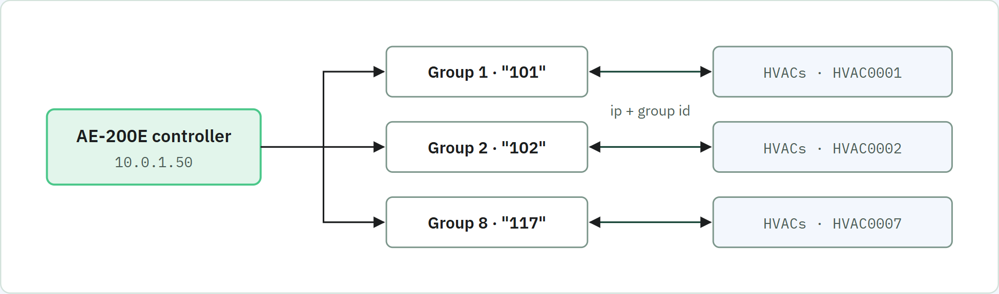
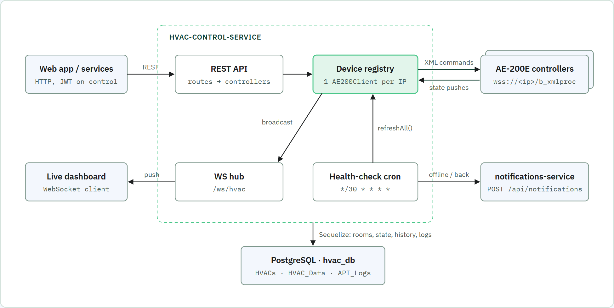
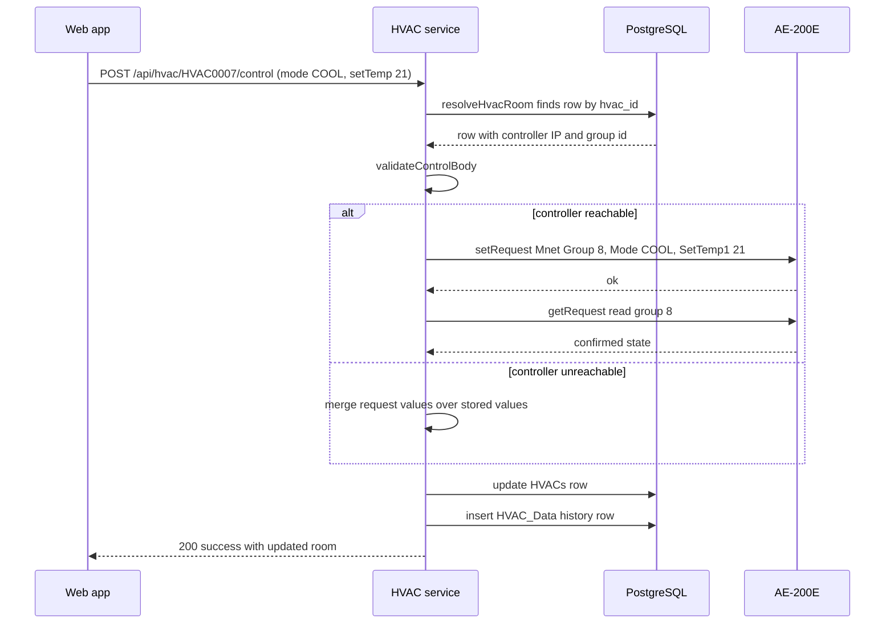
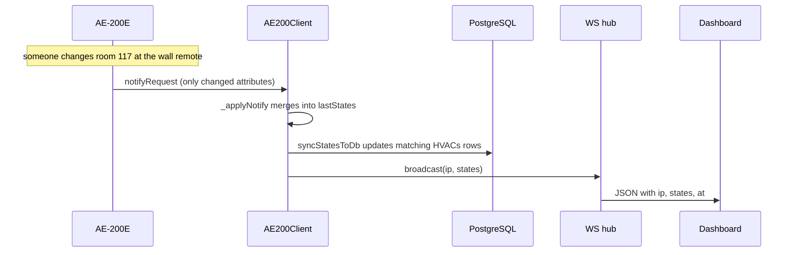
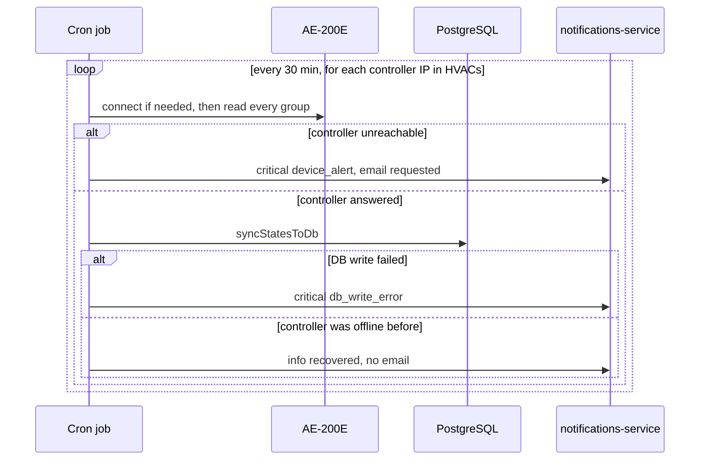

<p align="left"><br><b>Acacia Green Technologies</b></p>

# HVAC Control Service — Developer Guide

A Node.js service that connects to Mitsubishi **AE-200E** central controllers, reads and changes the air-conditioning in every room, stores the result in PostgreSQL, and pushes live changes to the dashboard.

| | |
|---|---|
| Runtime | Node.js + Express |
| Database | PostgreSQL via Sequelize |
| Device link | Secure WebSocket (WSS) + XML |
| Port | `3029` when deployed (`3099` if `PORT` is unset) |
| Docker image | `acaciagreentechnologies/hvac-service` |

**Contents**

1. [What the service does](#1-what-the-service-does)
2. [Key concepts](#2-key-concepts)
3. [Architecture](#3-architecture)
4. [How requests flow](#4-how-requests-flow)
5. [How state stays fresh](#5-how-state-stays-fresh)
6. [API reference](#6-api-reference)
7. [Control commands](#7-control-commands)
8. [Database](#8-database)
9. [Code map](#9-code-map)
10. [Run it locally](#10-run-it-locally)
11. [Build and deploy](#11-build-and-deploy)
12. [Common tasks](#12-common-tasks)
13. [Known issues](#13-known-issues)
14. [Glossary](#14-glossary)

---

## 1. What the service does

Each building has one or more **AE-200E controllers** on its network. A controller manages many indoor units, and each unit usually serves one room. This service is the bridge between those controllers and the rest of the Acacia360 platform.

| Capability | What it means |
|---|---|
| **Read** | See every room's live state: on/off, mode, set temperature, fan speed, louvre direction and the room temperature measured at the unit. |
| **Control** | Control one room, every room on one controller, or every room on every controller (the "master" control). |
| **Persist** | Every state change is written to the `HVACs` table. Every control action also adds a history row to `HVAC_Data`. |
| **Push** | When a controller reports a change, the service broadcasts it to browsers connected at `/ws/hvac`. |
| **Monitor** | A cron job checks every controller every 30 minutes and sends alerts to notifications-service when one goes offline or comes back. |
| **Audit** | Successful and failed API calls are written to the `API_Logs` table with the caller's email and role. |

---

## 2. Key concepts

You need three ideas before reading any code: **controller**, **group** and **room**.

- **Controller.** One physical AE-200E box, identified only by its **IP address** (for example `10.0.1.50`). The service opens one secure WebSocket to each controller and keeps it open.
- **Group.** The controller's own numbering for the indoor units it manages (Group 1, Group 2, …). Each group also has a web name, which in our buildings is usually the room number, such as `"117"`.
- **Room.** A row in our `HVACs` table. A row is linked to a real unit by the pair **`hvac_controller_ip` + `hvac_group_id`**. The row's public id is `hvac_id`, such as `HVAC0007`.



If a group has no matching row, the service still sees it but calls it **"untracked"** and does not store its state.

The service only knows about controllers whose IP appears in at least one `HVACs` row. At startup it reads the distinct `hvac_controller_ip` values and connects to each one.

---

## 3. Architecture



The **device registry** is the centre of the service. Everything that talks to a controller goes through it, and every state change it receives is saved to the database and broadcast to dashboards.

### Talking to the AE-200E

[`src/services/ae200-client.js`](../src/services/ae200-client.js) speaks the controller's own protocol, the same one its built-in web page uses:

- It opens `wss://<ip>/b_xmlproc/` with subprotocol `b_xmlproc`. The controller's self-signed certificate is accepted (`rejectUnauthorized: false`).
- It logs in with `AE200_USER` / `AE200_PASS`. The password is scrambled with the controller's key-based cipher before sending, copied from the vendor web UI.
- It loads the group list (`MnetList`) and system info (model, version, serial).
- Every message is an XML packet: `getRequest` to read, `setRequest` to control. The controller also sends unrequested `notifyRequest` packets when something changes.
- The protocol has no request ids, so the client **queues requests and sends one at a time**. It matches each reply by looking for an expected tag (for example `Mnet`), with a 10-second timeout.
- If the socket closes, it reconnects after 5 seconds, indefinitely.

---

## 4. How requests flow

### Middleware pipeline

Every HTTP request passes through these steps. Steps in brackets only apply to some routes.

```
cors → express.json → standardAPILogger → [authenticate] → [resolveDevice | resolveHvacRoom] → [validateControlBody] → controller → ok() / fail()
```

- `resolveDevice` turns `:ip` into a connected client on `req.client`, connecting on first use.
- `resolveHvacRoom` turns `:hvacId` into its `HVACs` row on `req.room`, or returns 404.
- Responses use `{ success: true, ... }` or `{ success: false, error }` from `utils/response.js`. Controller functions are wrapped in `asyncRoute`, so a thrown error reaches `errorAPILogger`, which logs it and replies with `{ message }`.

### Controlling a room

`POST /api/hvac/:hvacId/control` is the call the web app uses most. It sends the command, reads the unit back to confirm, and records what happened.



> If the controller cannot be reached, the service still saves the requested values. The database can then show a state the unit is not actually in until the next successful sync corrects it. See [Known issues](#13-known-issues).

### Startup sequence

1. `sequelize.sync({ alter: true })` creates or alters the tables to match the models.
2. It reads every distinct `hvac_controller_ip` from `HVACs`.
3. It connects to all of them in parallel. A failed controller is logged and the service still starts.
4. It schedules the health-check cron.
5. It creates the HTTP server, attaches the WS hub at `/ws/hvac` and listens on `PORT`.

On `SIGINT` or `SIGTERM` it closes every controller connection and exits.

---

## 5. How state stays fresh

The service does **not** poll on a timer. `startPolling()` exists but its call is commented out in `deviceRegistry.service.js`, so `POLL_INTERVAL` currently has no effect. State reaches the database in three ways:

| Trigger | When | What happens |
|---|---|---|
| **Device push** | Instantly, when anyone changes a unit (wall remote, vendor web UI, or this service) | The controller sends `notifyRequest` with only the changed attributes. The client merges them into its cache, saves them to the DB and broadcasts them over WS. |
| **On-demand read** | Each `GET /api/hvac/:ip` | Reads every group live, saves to the DB, then returns the rows. If the controller is down, it returns the last stored state. |
| **Health-check cron** | Every 30 minutes | Reads every group on every known controller, saves to the DB and sends alerts. |

### Push path



A partial push never wipes columns it doesn't carry, because `stateToHvacFields` only copies the attributes that are present.

### Health check and alerts



The service remembers which controllers are offline in memory, so a "recovered" alert fires only once, when a controller comes back. The "unreachable" alert is sent on every failed run. Deduplication depends on notifications-service's `notifications_dedup_key` (`hvac-device-error:<ip>:<type>`).

### WebSocket messages

Browsers connect to `ws://<host>:<port>/ws/hvac`. Each message looks like this:

```json
{
  "ip": "10.0.1.50",
  "states": {
    "8": { "group": "8", "name": "117", "drive": "ON", "mode": "COOL",
           "setTemp": "21.0", "fanSpeed": "AUTO", "airDirection": "SWING",
           "inletTemp": "23.5", "updatedAt": "2026-09-30T09:14:02.118Z" }
  },
  "at": "2026-09-30T09:14:02.120Z"
}
```

Field values such as `AUTO` and `SWING` are illustrative. The controller sends its own strings, and the service passes them through unchanged.

---

## 6. API reference

The base URL is `http://<host>:3029`. **JWT** means the request needs `Authorization: Bearer <token>`, signed with `JWT_SECRET`. `:ip` must look like an IPv4 address.

### Health

| Method | Path | Auth | What it does |
|---|---|---|---|
| GET | `/health` | open | Plain `OK`. Used by Kubernetes liveness and readiness probes. |
| GET | `/api/health` | open | JSON `{ status: "ok", timestamp }`. |

### Rooms (database-backed, used by the web app)

| Method | Path | Auth | What it does |
|---|---|---|---|
| GET | `/api/hvac/:ip` | open | Live-refreshes the controller, saves the result, and returns its rooms sorted by group. If the refresh fails, it returns stored data. It returns 404 if the IP has no rooms. |
| GET | `/api/hvac/:ip/sync` | open | Saves the client's *cached* states (no live read). Returns `updatedCount` and `untrackedGroups`. Returns 409 if nothing is cached yet. |
| POST | `/api/hvac/:hvacId/control` | open | Controls one room by `hvac_id`, updates its row and adds a history row. |

### Devices (talk to the controller directly)

| Method | Path | Auth | What it does |
|---|---|---|---|
| GET | `/api/devices` | open | Lists every controller from the DB and the connection pool, with `connected`, `systemInfo`, `groupCount` and `hvac_property_id`. |
| GET | `/api/devices/:ip/groups` | open | Returns the group list (number and name). |
| GET | `/api/devices/:ip/units` | open | Returns cached unit states instantly, without contacting the controller. |
| GET | `/api/devices/:ip/units/:group` | open | Reads one group live. |
| POST | `/api/devices/:ip/units/:group/control` | **JWT** | Controls one group. **It does not update the DB directly.** The device push that follows does. |
| POST | `/api/devices/:ip/units/all/control` | **JWT** | Controls every group on one controller, one after another, and updates matching rows and history. Returns a result for each group. |
| POST | `/api/units/all/control` | **JWT** | **Master control.** Sends the same command to every group on every connected controller. |

### Logs

| Method | Path | Auth | What it does |
|---|---|---|---|
| GET | `/api/hvacLogs` | open | Returns every `API_Logs` row, newest first. There is no pagination. |

Any other path returns 404 with a list of valid routes. A ready-made Postman collection is in [`postman_collection.json`](../postman_collection.json).

---

## 7. Control commands

All control endpoints take the same JSON body. Send at least one of these fields:

| Field | Values | Notes |
|---|---|---|
| `drive` | `ON`, `OFF` | Power. |
| `mode` | `COOL`, `HEAT`, `FAN`, `AUTO`, `DRY`, `AUTOCOOL` | Validated. The controller's `AutoCool` / `AutoHeat` readings are shown as `AUTO`. |
| `setTemp` | °C, e.g. `21` | Target for COOL, HEAT and DRY. |
| `setTempCool` | °C | AUTO only: the upper threshold, where cooling starts. |
| `setTempHeat` | °C | AUTO only: the lower threshold, where heating starts. |
| `fanSpeed` | controller string | Passed through unchecked. |
| `airDirection` | controller string | Passed through unchecked. |

```bash
# Cool room HVAC0007 to 21 °C
curl -X POST http://localhost:3029/api/hvac/HVAC0007/control \
  -H "Content-Type: application/json" \
  -d '{"drive":"ON","mode":"COOL","setTemp":21}'

# Auto mode with an 18–23 °C band on every unit of one controller
curl -X POST http://localhost:3029/api/devices/10.0.1.50/units/all/control \
  -H "Authorization: Bearer $TOKEN" -H "Content-Type: application/json" \
  -d '{"mode":"AUTO","setTempCool":23,"setTempHeat":18}'
```

### Set temperature has one slot per mode

The AE-200E keeps a separate remembered setpoint for each mode. The plain `SetTemp` attribute is ignored for most modes, so the client writes to the slot for the active mode:

| Mode | XML attribute written |
|---|---|
| COOL | `SetTemp1` |
| HEAT | `SetTemp2` |
| DRY | `SetTemp3` |
| FAN | `SetTemp` |
| AUTO | `SetTemp1` (cool) + `SetTemp2` (heat) |

COOL and AUTO were confirmed on real hardware. HEAT and DRY follow Mitsubishi's documented convention but have not been verified on our units. See the `MODE_SETTEMP_INDEX` comment in `ae200-client.js`. All temperatures are rounded to the nearest 0.5 °C and formatted like the vendor UI, for example `"21.0"`.

---

## 8. Database

There are three tables. They are created and altered automatically at startup by `sequelize.sync({ alter: true })`. There are no migration files.

### `HVACs`: one row per room

| Column | Meaning |
|---|---|
| `id` | Integer primary key. `HVAC_Data.hvac_id` points here. |
| `hvac_id` | Public id used in URLs, e.g. `HVAC0007`. Unique together with `hvac_room_id`. |
| `hvac_controller_ip` + `hvac_group_id` | **The link to the real unit.** The service only saves state for rows that have both. |
| `hvac_room_id`, `hvac_property_id` | Links to the platform's rooms and properties. The property id also decides who receives alerts. |
| `hvac_status`, `hvac_operation_mode`, `hvac_temperature`, `hvac_temperature_cool`, `hvac_temperature_heat`, `hvac_fan_speed`, `hvac_air_direction`, `hvac_inlet_temperature` | The latest known live state, overwritten on every sync. Temperatures are stored as strings. |
| `update_at` | When the state was last read or changed. Note the spelling: `update_at`, not `updated_at`. |
| brand, model, serial, dates, notes … | Descriptive asset fields. The service does not change them. |

### `HVAC_Data`: control history

The service adds one row each time someone **controls** a unit through the room endpoint or the "all" endpoints. Device pushes and polls do **not** add rows, so this table records actions, not a temperature time series. It stores status, mode, `setTemp`, fan, direction, inlet temperature, controller IP, property, room and timestamp. In AUTO mode `hvac_temperature` is null because the cool/heat thresholds aren't stored here.

### `API_Logs`: request audit

Rows record method, endpoint, status code, message, `SUCCESS` / `ERROR`, and the caller's email and role, or `anonymous` / `guest`. Successful responses (status below 400) are logged when they finish. Errors are logged only when they reach `errorAPILogger`. A 4xx sent directly with `fail()`, such as a validation error, is **not** logged.

---

## 9. Code map

Read these files in this order and you will understand most of the service within an hour:

1. [`src/app.js`](../src/app.js): wiring, startup, shutdown.
2. [`src/routes/index.js`](../src/routes/index.js) and the three route files: which middleware each endpoint uses.
3. [`src/controllers/hvac.controller.js`](../src/controllers/hvac.controller.js): the room endpoints the web app uses.
4. [`src/services/deviceRegistry.service.js`](../src/services/deviceRegistry.service.js): the client pool and `onStateUpdate` (save + broadcast).
5. [`src/services/ae200-client.js`](../src/services/ae200-client.js): the controller protocol. This is the hardest file, so read it last.

| Path | Responsibility |
|---|---|
| `src/app.js` | Express setup, 404 handler, startup sequence, signal handling. |
| `src/config/database.js` | Sequelize connection from `DB_*` env vars. Logs every SQL query. |
| `src/routes/` | `device.routes`, `control.routes`, `hvac.routes`, `logRoutes`. `hvac.test.js` lives here too. |
| `src/controllers/` | Thin handlers: `device`, `control`, `hvac`, `health`, `logController`. |
| `src/middleware/` | `authenticate` (JWT), `authorize` (role check, currently unused), `resolveDevice`, `resolveHvacRoom`, `validateControlBody`, `apiLogger`. |
| `src/services/ae200-client.js` | WebSocket connection, login cipher, XML building and parsing, request queue, reconnect, push handling. |
| `src/services/deviceRegistry.service.js` | Map of IP → client, known IPs from the DB, `controlAll`. |
| `src/services/hvacSync.service.js` | `stateToHvacFields` (client state → DB columns) and `syncStatesToDb`. |
| `src/services/hvacHistory.service.js` | `recordAction`: writes one `HVAC_Data` row. |
| `src/services/wsHub.service.js` | Browser WebSocket server at `/ws/hvac` and `broadcast`. |
| `src/services/deviceHealth.service.js` | Tracks which controllers are offline and calls the notification client. |
| `src/services/notificationClient.js` | HTTP calls to notifications-service (5-second timeout, errors swallowed). |
| `src/cron/hvacHealthCheck.cron.js` | The 30-minute health check. |
| `src/scripts/seed-hvac.js` | Creates a room row for every group on every known controller. |
| `src/scripts/sync-db.js` | Creates the tables without starting the server. |

---

## 10. Run it locally

You need Node.js, a PostgreSQL database, and **network access to the controllers**, which are on the building's private network. Without that access the API still starts, but controller calls fail and room endpoints return stored data.

```bash
npm install

# .env in the repo root
DB_HOST=localhost
DB_PORT=5432
DB_USER=postgres
DB_PASSWORD=postgres
DB_NAME=hvac_db
PORT=3029                      # defaults to 3099 if unset
JWT_SECRET=local-dev-secret
AE200_USER=administrator       # controller login
AE200_PASS=********
NOTIFICATIONS_SERVICE_URL=http://localhost:3005

npm start                      # node src/app.js
curl http://localhost:3029/health
```

| Variable | Default in code | Used for |
|---|---|---|
| `DB_HOST` / `DB_PORT` / `DB_USER` / `DB_PASSWORD` / `DB_NAME` | none | PostgreSQL connection. |
| `PORT` | `3099` | HTTP + WS port. Docker and Kubernetes use `3029`. |
| `JWT_SECRET` | none | Verifying tokens on the control routes. |
| `AE200_USER` / `AE200_PASS` | `administrator` / `admin` | Controller login. |
| `NOTIFICATIONS_SERVICE_URL` | `http://localhost:3005` | Sending alerts. |
| `POLL_INTERVAL` | `30` | Unused while polling is disabled. |

### Tests

`npm test` runs Jest on `src/routes/hvac.test.js`. The controller, sync and history services are mocked, but the test **does connect to a real PostgreSQL database** and runs `sync({ force: true })`, which **drops and recreates every table**. Only point it at a throwaway database.

---

## 11. Build and deploy

### CI/CD pipeline

`.github/workflow/CICD-Pipeline.yaml` is meant to run on pushes and pull requests to `main`:

1. **build-and-test**: checks out this repo and `Acacia360/acacia360-app-chart`, reads the shared DB host and port from the chart's `values.yaml`, installs dependencies on Node 24, runs Jest and publishes a JUnit report.
2. **call-central-pipeline**: runs only after the tests pass. It calls the chart repo's reusable pipeline, which builds and pushes `acaciagreentechnologies/hvac-service` and deploys it with Helm.

### Manual deploy

[`deploy-hvac.ps1`](../deploy-hvac.ps1) builds and pushes the `:1.0` tag, then restarts the running deployment:

```powershell
docker build --no-cache -t acaciagreentechnologies/hvac-service:1.0 .
docker push acaciagreentechnologies/hvac-service:1.0
kubectl rollout restart deployment/acacia360-app-acacia360-app-chart-hvac -n acacia360
kubectl rollout status  deployment/acacia360-app-acacia360-app-chart-hvac -n acacia360
```

The live deployment comes from the Helm chart in `acacia360-app-chart` (namespace `acacia360`). The plain manifests in `k8s/hvac/` (2 replicas, probes on `/health`, 100m–500m CPU, 128–512 Mi memory) look like an older standalone setup. Check the chart before relying on them.

---

## 12. Common tasks

### Add a new controller or building

1. Insert at least one `HVACs` row with the new controller's `hvac_controller_ip`. The service only discovers controllers from this table.
2. Edit `PROPERTY_ID` and `LOCATION` at the top of `src/scripts/seed-hvac.js`. They are currently hardcoded to `'1'` and `'Fitzrovia'`.
3. Run `node src/scripts/seed-hvac.js`. It connects to every known controller, creates one row per group (`HVAC0001`, `HVAC0002`, … after the highest existing number) and refreshes state on rows that already exist. If a group's name is numeric, it becomes `hvac_room_id`.
4. Delete or fix the placeholder row from step 1. It has no group id, so it will never sync.
5. Restart the service so it connects at startup, or call `GET /api/hvac/<ip>` to connect it straight away.

### Add a controllable attribute

1. Add the key to `validKeys` in `validateControlBody.js`.
2. Add the XML attribute in `buildControlXml`, and read it in `buildReadGroupXml`, `_parseState` and `_applyNotify`.
3. Add a column to `models/HVAC.js` and map it in `stateToHvacFields`. Add it to `HVACData` / `recordAction` if it belongs in history.
4. Update the fallback object in `controlRoom` so it also works when the controller is offline.

### Add an endpoint

Add a handler in the relevant controller, wrap it in `asyncRoute`, and register it in the matching route file with the middleware it needs. Add `authenticate` if it changes anything. If the path overlaps a parameterised one, register the fixed path first, as `/units/all/control` is registered before `/units/:group/control`. Add the path to the 404 list in `app.js`.

---

## 13. Known issues

These were found while writing this guide. They are listed so you are not surprised by them.

| Area | Issue |
|---|---|
| **Security** | **Most routes have no authentication.** Only the three routes in `control.routes.js` use `authenticate`. `POST /api/hvac/:hvacId/control`, every read route and `/api/hvacLogs` are open. `authorize` is never used. |
| **Tests** | **Tests drop tables, and CI points at the shared DB host.** The test runs `sync({ force: true })`. The workflow sets `DB_HOST` to `global.sharedDbHost` from the Helm chart instead of the local `postgres` service container it starts. Confirm that host can never be a real database. |
| **CI** | **The workflow folder name looks wrong.** The file is in `.github/workflow/`. GitHub Actions only runs workflows from `.github/workflows/` (plural), so this pipeline probably does not trigger. |
| **Behaviour** | **Offline control still saves to the database.** When the controller cannot be reached, `controlRoom` saves the requested values and returns 200. The room then shows a state the unit is not actually in until the next successful sync. |
| **Behaviour** | **Any IP in a URL opens a lasting connection.** `resolveDevice` connects to any valid-looking IP and keeps the client in memory, even if the connection fails. A failed client keeps retrying every 5 seconds, and later calls to that IP return "Not connected" without trying afresh. |
| **Scaling** | **Every replica does all the work.** Each pod connects to every controller and runs its own cron, so with 2 replicas you get duplicate syncs and alerts, and every controller has one open session per pod. The offline/online state is in memory and resets on restart. |
| **Docs** | **README.md is out of date.** It describes CRUD endpoints, Milesight gateways and a one-minute data logger that no longer exist. Trust this guide and the code. |
| **Config** | **Config drift.** The default port in code is 3099, but deployed services use 3029. `docker-compose.yml` is a fragment (no `services:` key, wrong build path, port 4000). `k8s/hvac/hvac-secret.yaml` contains credentials in plain text. `AE200_USER`/`AE200_PASS` are not in the k8s config, so the defaults are used. |
| **Logging** | **API log gaps.** 4xx responses sent with `fail()` are not logged. The logger records `req.user.user_role`, but tokens seem to carry `user_role_name` (the field `authorize` checks), so roles are logged as `guest`. |

---

## 14. Glossary

| Term | Meaning |
|---|---|
| **AE-200E** | Mitsubishi Electric's centralised controller. One box manages up to dozens of indoor units over the M-NET bus and has its own web UI at `https://<ip>/`. |
| **M-NET** | Mitsubishi's bus between the controller and the units. It is why unit elements are called `<Mnet>` in the XML. |
| **Group** | A numbered unit or zone on a controller. Groups map to rooms. |
| **Drive** | The unit's power state, `ON` or `OFF`. It is stored as `hvac_status`. |
| **Inlet temp** | Room air temperature measured where air enters the unit. This is the room's actual temperature, and it is read-only. |
| **Set temp** | The target temperature. In AUTO there are two: cool and heat thresholds. |
| **notifyRequest** | A packet the controller sends by itself when a unit changes. |
| **Untracked group** | A group on a controller with no matching `HVACs` row. Its state is visible but not saved. |

---

*Written from the code on `main` at commit `c3c9c0a`, 30 September 2026. If the code and this guide disagree, the code is right, so please update the guide.*
